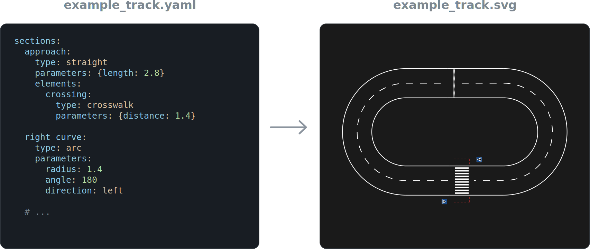
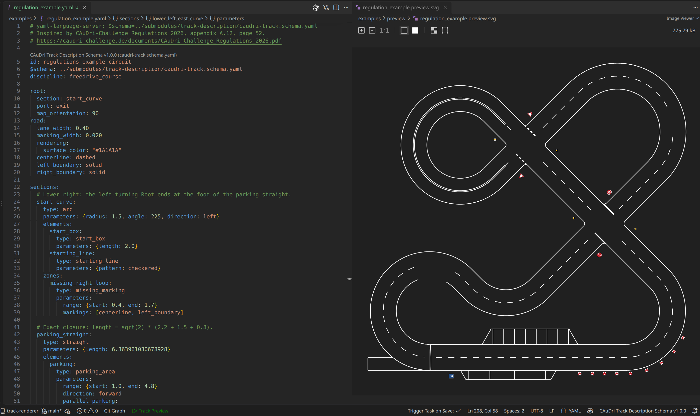
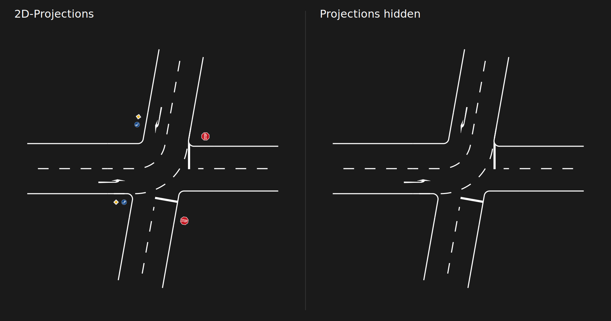

# CAuDri Track Renderer

Python library and CLI tool for rendering CAuDri-Challenge
[track descriptions](https://github.com/CAuDri/track-description).

The renderer supports all road sections, elements, markings and other track objects that can be defined in a track description. 
By default, it outputs a SVG with inlcuded metadata that allows other applications to relate visible objects back to their source description.

To use the output in a visualizer, editor or simulation, see the
[SVG format guide](docs/svg_format.md) for geometry, object ownership and physical placements.

[](docs/examples/example_track.yaml)

### Features

- YAML and JSON input using the CAuDri Track Description format
- Full support for the track description catalog:
    - Straight sections, arcs, clothoids and intersections, including branches and loops
    - Road surfaces, continuous lane markings and marking changes across section boundaries
    - Crosswalks, parking areas, barred areas, signs, obstacles, landmarks, etc.
- Embedded graphics for traffic signs, landmarks or custom markers
- Metadata containing section and element identities, source references, physical objects (obstacles, start box, etc.) and their resolved poses
- Select/filter individual sections and their owned objects
- Optional 2D depictions of 3D objects (traffic signs, landmarks, obstacles, etc.)
- Schema and geometry validation, with diagnostics linked to the description

## Install

Requires Python **3.11 or newer** and Git.
Clone the repository together with the Track Description submodule:

```sh
git clone --recurse-submodules https://github.com/CAuDri/track-renderer.git
cd track-renderer
```

If you already cloned the repository, initialize the submodule with
`git submodule update --init --recursive`.

Create a virtual environment and install the package. On Linux or macOS:

```sh
python3 -m venv .venv
source .venv/bin/activate
python -m pip install .
```

On Windows:

```powershell
py -3 -m venv .venv
.\.venv\Scripts\Activate.ps1
python -m pip install .
```

For JPEG output, install the optional image dependencies as well:

```sh
python -m pip install ".[image]"
```

For local library development, use `python -m pip install -e ".[image,dev]"`
to install additional development tools.

## VS Code Usage

In VS Code you can open the repository folder and select the Python interpreter from the virtual environment. 

While editing a track description you can simply render and show a preview using the configured build task (CTRL+Shift+B) or the "Track Preview" button below. 

While the preview is open, the renderer will automatically update the drawing when saving the track description. 



## CLI

You can run the renderer from the command line using `track-render` or `python -m track_renderer`:

```sh
track-render example_track.yaml -o example_track.svg
```

This will render the track description in `example_track.yaml` to an SVG file named `example_track.svg`. 
When omitting the `-o` output file, the output goes to stdout.

The track will always be validated before rendering. You can use `--force` to attempt rendering even if validation fails.

### Output formats

The default output format is SVG. You can generate a JPEG instead:

```sh
track-render example_track.yaml -o example_track.jpg --dpi 10
```

The resolution of the JPEG can be controlled with `--dpi` (dots per inch) or `--width` for the total pixel width of the track. Default is 20 DPI (approximately 790 pixels per meter).

The SVG output uses a physical 1:1 scale, so the resulting drawing can be quite large. 
For SVG viewers that do not support zooming, you can use `--scale` to reduce the size of the drawing or `--svg-responsive` to auto-fit the drawing with most viewers. 

### 2D projections

By default, the renderer draws 2D projections of 3D objects such as traffic signs, landmarks and obstacles. 
They can be hidden globally using `--no-projections` or selectively using `--pose-only [TYPE]` for one or more supported object types.
This way, only the actual road surfaces and markings will be shown, while the objects themselves and their positions will still be included in the metadata. 

<p align="center">
  
</p>


### Options

```text
track-render TRACK [options]
```

| Argument / option | Meaning |
| --- | --- |
| `TRACK` | Path to a YAML or JSON track description. |
| `-h`, `--help` | Show command-line help. |
| `-o PATH`, `--output PATH` | Write to a file instead of stdout. |
| `--format {svg,jpg}` | Override the output format. Defaults to `svg` without an output path. |
| `--section ID` | Render only this section and its owned objects. Can be repeated for multiple sections. |
| `--force` | Attempt to render usable parts despite validation or rendering failures. |
| `--no-projections` | Hide all optional 2D depictions; retain physical parts and poses. |
| `--pose-only TYPE` | Hide the optional depiction of one supported object type. Repeatable. |
| `--curve-tolerance FLOAT` | Maximum chord error when approximating curves, in meters. Defaults to the selected catalog's value. Smaller values produce more drawing points. |
| `--margin FLOAT` | Background margin around SVG or JPEG output, in meters. Nonnegative and finite; default `0.5`. |
| `--scale FLOAT` | Physical SVG scale denominator: `10` means 1:10, default `1`. Has no effect with `--svg-responsive`. |
| `--svg-responsive` | Omit physical SVG width and height, retaining the `viewBox` so the drawing fits its viewer. |
| `--dpi FLOAT` | JPEG dots per inch of the full-size track, including margin. Default `20`. |
| `--width INT` | JPEG width in pixels. Positive; overrides DPI-based pixel sizing and preserves the aspect ratio. |
| `--report PATH` | Save a JSON report containing rendering completeness, validation results and diagnostics. |

Argument errors and some input/output failures occur before a report can be
written. When integrating the CLI into another tool, also check its exit code:

| Exit code | Meaning |
| --- | --- |
| `0` | Validation succeeded and rendering is complete. Warnings may still be present. |
| `1` | Validation failed or could not finish, or rendering is incomplete. `--force` may still have produced output. |
| `2` | An argument, input or output error prevented completion. |

## Python API

A Python API is available that offers similar functionality to the CLI. 
It can be used by downstream tools to easily load and render track descriptions.

A comprehensive overview of the API can be found here: [docs/python_api.md](docs/python_api.md). [TODO]

```python
from track_renderer import load_svg, render

drawing = render("examples/intersection_showcase.yaml")
drawing.write("track.svg", responsive=True)

crossing = drawing.select_sections(["crossing"])
crossing.write("crossing.svg", responsive=True)

saved = load_svg("track.svg")
print(saved.track_id, len(saved.objects), saved.bounds())
```

## Output format

The generated SVG contains `metadata` that describes the track and its components similar to the source track description. 

Downstream tools can use this metadata to relate geometry back to owning sections, elements and physical objects (i.e. which section or element does this paticular surface marking belong to).

A overview of the metadata format can be found in the SVG docs: [docs/svg_format.md](docs/svg_format.md). [TODO]

## License

MIT License, Copyright (c) 2026 CAuDri e.V. See [LICENSE](LICENSE).
