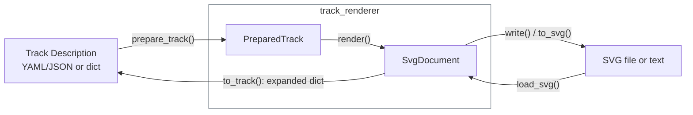

# Python API

The `track_renderer` package provides a Python interface that can be used for downstream tools, like visualisers, editors and simulations.

It can read a track description and validate it against its schema. It outputs an [`SvgDocument`](#svgdocument), that can be saved and reloaded from an SVG file. 

See [installation](../README.md#install) and the [SVG format docs](svg_format.md) for setup and output details.

## Quick start

Import names from `track_renderer`.

You can run this from the repository root using the [example track](../examples/track.yaml):

```python
from track_renderer import render

drawing = render("examples/track.yaml")
drawing.write("track.svg", responsive=True)
```

## Input + Rendering

| Function | Result |
| --- | --- |
| `render(track, *, source_uri=None, force=False, options=None)` | Prepare input and return a new `SvgDocument` |
| `prepare_track(track, *, source_uri=None)` | Expand defaults, validate structure and geometry, return a reusable `PreparedTrack` |
| `load_svg(source)` | Load a renderer SVG from a path, XML string or UTF-8 bytes |

- **Input:** `render()` and `prepare_track()` accept a path, URI, description dictionary or `PreparedTrack`.
- **In-memory input:** For relative file references in the track description dict, pass the source document's absolute URI as `source_uri`, e.g. `Path("track.yaml").resolve().as_uri()`.
- **SVG (re-)loading:** Annotated renderer SVGs can be reloaded with `load_svg()`. Full exports also retain the expanded track description.



### Render options

Pass `RenderOptions(...)` through `render(..., options=...)`.

| Option | Default | Meaning |
| --- | --- | --- |
| `projections` | `True` | Enable optional object depictions |
| `pose_only` | `frozenset()` | Hide depictions for these types, e.g. `{"traffic_sign"}` |
| `curve_tolerance` | `None` | Maximum chord error in meters; positive and finite. `None` uses the catalog default |

`pose_only` accepts `traffic_sign`, `landmark`, `static_obstacle`,
`dynamic_obstacle`, `pedestrian` and `crosswalk_waiting_area`.
Disabling projections retains all object records, physical parts and poses, road
surfaces, paint and selection regions.
It essentially just turns them invisible in the output.

## SvgDocument

| Member | Contents |
| --- | --- |
| `objects` | Source objects keyed by ID: type, properties, parent and owning section |
| `parts` | Physical components keyed by part ID: `object_id`, role, pose and dimensions |
| `assets` | Artwork records keyed by content hash |
| `metadata` | Complete metadata dictionary |
| `track_id`, `schema_uri`, `map_orientation` | Track identity, schema URI and display rotation in degrees |
| `root` | Mutable SVG XML root (`xml.etree.ElementTree.Element`) |
| `complete`, `validation`, `diagnostics` | Render status, input validation and findings |
| `bounds()` | Conservative painted bounds `(left, bottom, right, top)` in the unrotated Map frame, or `None` |
| `validate()` | Check SVG structure, artwork and metadata references. |
| `to_track()` | Reconstruct an independent expanded Track Description dictionary from a full drawing's metadata. |

- A geometry group's `data-object-id` and a part's `object_id` identify records in `objects`.
- Poses use **meters and degrees in the Map frame**; display rotation does not change them.
- Metadata access returns independent values. Editing `root` changes presentation, but does not update physical poses or the source description.

### Selecting sections

Independent sections can be extracted from a full drawing:

```python
from track_renderer import load_svg

drawing = load_svg("track.svg")  # Saved by the first example.
section = drawing.select_sections(["west_approach"])
section.write("west_approach.svg", responsive=True)

for part in section.parts.values():
    print(part["object_id"], part["pose"])
```

- Accepts short names or full IDs such as `/sections/west_approach`.
- Returns an independent document with owned objects, parts and artwork. 
- Global actors are excluded; coordinates and paint order stay unchanged.
- Fits the viewport by default. `fit_viewbox=False` preserves the original frame.

## Export

| Call | Result |
| --- | --- |
| `drawing.to_svg(...)` or `export_svg(drawing, ...)` | SVG text |
| `drawing.write(path, ...)` | Save SVG to a file |
| `export_jpg(drawing, ...)` | Opaque JPEG bytes; requires the `image` extra and native Cairo |
| `write_file(path, content)` | Atomical save, e.g. `write_file("track.jpg", export_jpg(drawing, width=1200))`. |

### Export options

| Option | Applies to | Default | Meaning |
| --- | --- | --- | --- |
| `margin` | SVG, JPEG | `0.5` | Nonnegative, finite viewport padding in meters (includes the road surface) |
| `responsive` | SVG | `False` | Omit physical dimensions, keep the viewBox for resizable viewers |
| `scale` | SVG | `1` | Positive, finite physical scale denominator: `10` means 1:10. No effect with `responsive=True`. |
| `metadata` | SVG | `True` | `False` exports a smaller illustration without track annotations or invisible selection regions |
| `dpi` | JPEG | `20` | Resolution at full Map scale; around 790 pixels per meter by default |
| `width` | JPEG | `None` | Positive integer pixel width; overrides DPI-based sizing, preserving aspect ratio |
| `quality` | JPEG | `95` | Integer from 1 to 100. |

Output directories must exist. SVG loading and export require the renderer's
[supported SVG profile](svg_format.md#interoperability). JPEG requires visible geometry.

`drawing.write("illustration.svg", metadata=False)` removes all metadata but leaves the drawing unchanged. 
This lowers the file size of the exported SVG, useful for publication or simple illustration. 
The exported file cannot be reloaded with `load_svg()`.

## Errors and validation

| Exception | Meaning |
| --- | --- |
| `RenderError` | Input loading, validation or rendering failed; inspect `error.diagnostics` |
| `SvgError` | Invalid/unsupported SVG or section selection; inspect `error.path` |
| `ValueError` | Invalid options; also the base class of both errors above |
| `OSError` | File access failed |

- `render(..., force=True)` attempts a partial preview and retains findings. It does not bypass validation, unreadable input still fails.
- Check **both** `drawing.complete` and `drawing.validation["valid"] is True` before treating a result as complete and valid.
- `Diagnostic` records provide `code`, `message`, `severity`, `path`, optional `source` and `details`; `to_dict()` returns serializable data.
- Full competition-rule validation is not performed and needs to be done separately. 

## Reuse + Caching

| Change | What to do |
| --- | --- |
| Description, schema or catalog | Prepare and render again. Existing `PreparedTrack` objects do not detect changes. |
| Drawing options or artwork | Render the same prepared revision again. |
| Section selection or export settings | Reuse the full `SvgDocument`. |

Local schema bundles are cached automatically. Each render rebuilds the drawing;
there is no automatic cache (yet) for rendered results or partial rebuild after edits.

For an application cache, use `renderer_fingerprint()` and the resource contents listed by `dependency_uris(prepared, drawing)`, together with input contents and render/selection/export options. 