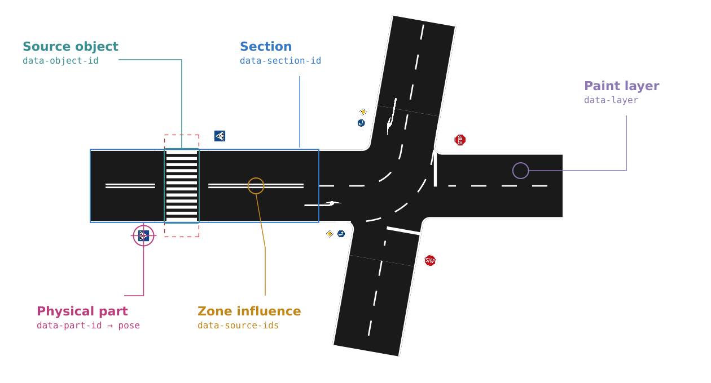
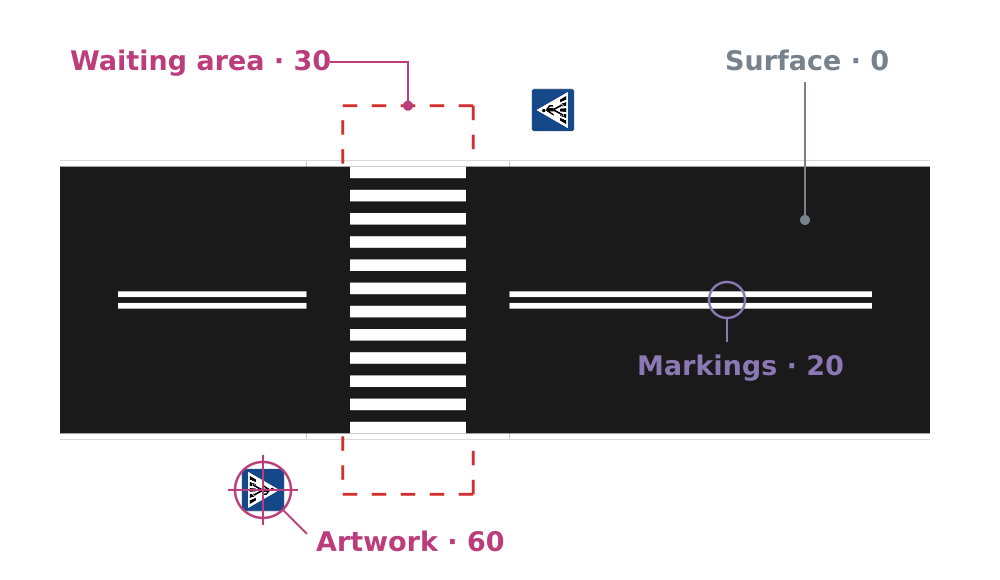
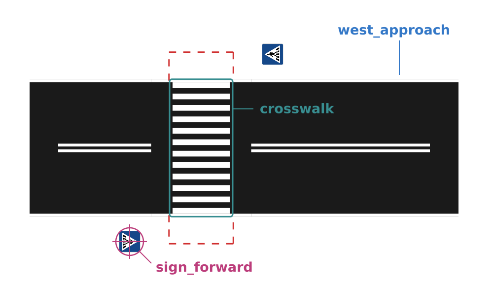
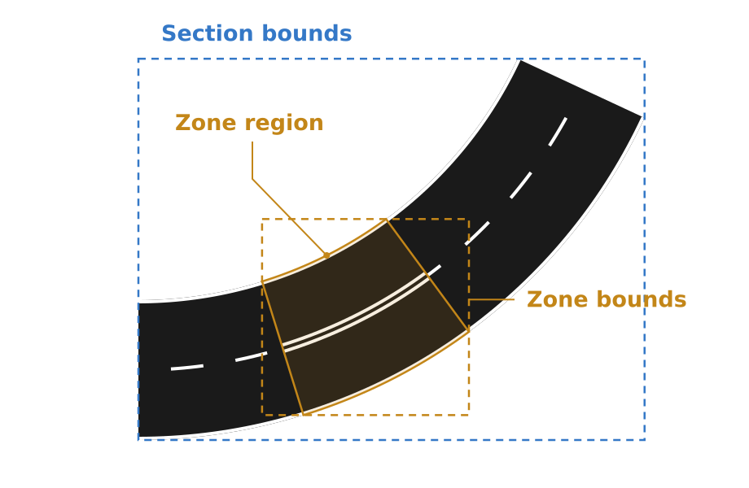
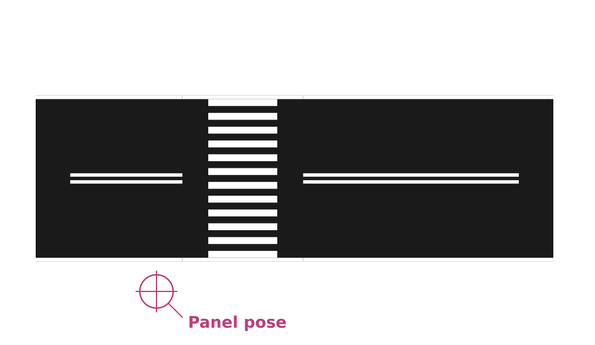
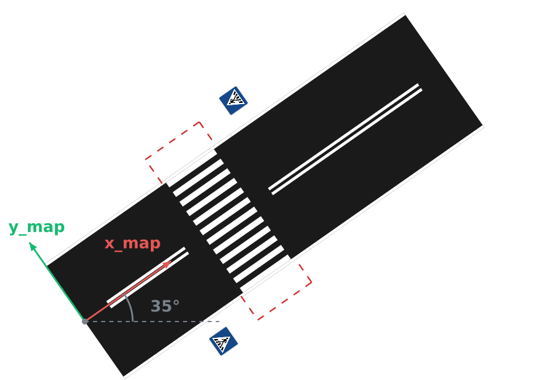
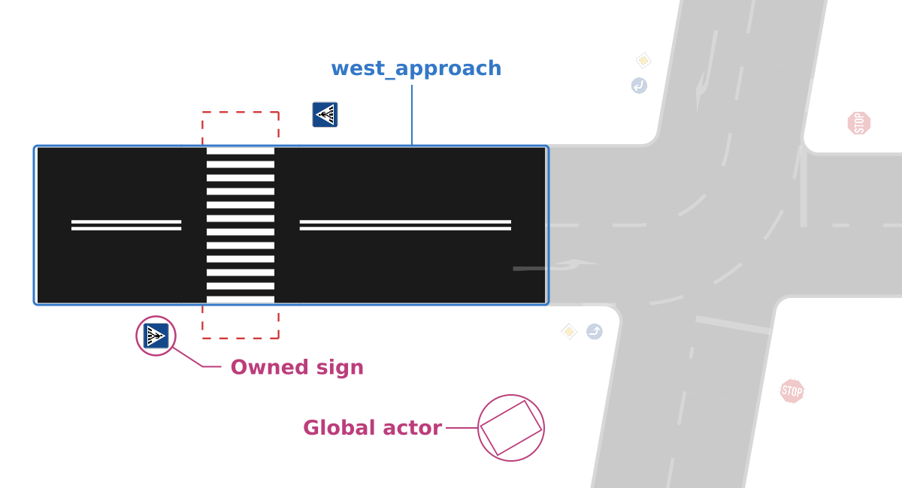

# Track Renderer -  SVG Format



By default, the track renderer produces a self-contained SVG file with embedded artwork and additional metadata.
Any SVG viewer should be able to display it.

The additional annotations describe which source objects every drawn shape belongs to and where physical components are placed.
This way, downstream tools like visualizers or simulators can use this information to apply meaning to the drawn geometries (e.g. hide a specific road element, isolate a single section, or place a 3D object at the correct location).

Shapes, layers and transforms use a common SVG format. Track-specific concepts such as section ownership and physical poses are defined by this library and stored in the SVG metadata and `data-*` attributes.

Throughout this document, the [example track](../examples/track.yaml) and its [rendered SVG](img/track.svg) are used to demonstrate the format and can be used as a reference.

## Document structure

The root `svg` defines the viewport and carries `data-track-id` and
`data-complete`. Its main children are:

| Element | Contents |
| --- | --- |
| `metadata` | Object identities, physical parts, artwork information and render status |
| `title` | Track identifier |
| `defs` | Shared, embedded artwork (i.e. traffic sign icons) |
| `rect#background` | Viewport background (track surface) |
| `g#map` | Drawn geometry, grouped into paint layers. |

Within `map`, groups with `data-layer` establish the paint order: surfaces lie
below markings and object depictions. A section spans several layers so that
overlapping sections remain correctly ordered. Source ownership is therefore
recorded through IDs rather than a nested group for each section.

<p align="center">
  
</p>

Each layer contains **geometry groups**, each with one `path`, `polyline` or
`use`. Semantic attributes belong to the group, not the child shape.

Curves are sampled to the rendering tolerance.

A `use` references an embedded `image` in `defs`.
Its transform places and sizes the artwork independent of the original image dimensions.
The paint order and the complete SVG transform chain determine the final visible result.
External artwork files are not required for viewing, but are still referenced in the metadata.

## Geometry and source objects

One source object can produce many shapes.
In the reference track, all crosswalk stripes share a crosswalk owner.
The generated signs have their own object IDs and refer to the crosswalk as their parent.
Both belong to the `west_approach` section.

<p align="center">
  
</p>

| Geometry-group attribute | Meaning |
| --- | --- |
| `id` | Unique XML ID |
| `data-geometry-id`, `data-role` | Drawing ID and its role within the owner |
| `data-object-id` | Owning record in the metadata's `objects` map |
| `data-purpose` | `physical` for surfaces and paint, `projection` for optional depictions, or `selection` for invisible regions |
| `data-section-id`, `data-parent-id` | Owning section and immediate parent, when present |
| `data-part-id` | Associated physical-part record, when applicable |
| `data-source-ids` | JSON array of contributing object IDs; absent means none |
| `data-placement-section-id` | Separately recorded placement section; currently used for zone selection regions |

Ownership describes where an object belongs in the source, independently of its
position. Contributors describe what influenced a shape: the reference's double
centerline belongs to the road section, while `data-source-ids` identifies the
zone that changed its appearance. Selection regions represent interaction areas,
not physical surfaces; they have zero opacity and enabled pointer events.

<p align="center">
  
</p>

Object IDs are JSON pointers into the **expanded description**, including generated objects.
An object's ID stays stable while its source path stays the same.
Individual drawing elements can change when geometry is recomputed, so geometry IDs and XML IDs are distinct from the source identity.

### Curved sections and zones

On a [curved section](../examples/curved_track.yaml), the zone's selection region follows the road. Rectangular bounds also enclose empty space.

> **Hint:** The boxes below are computed from the road surface and zone-selection geometry in the
> [example SVG](img/curved_track.svg). They are not exposed as additional metadata fields.  
> If you require the bounding boxes for your own use, let us know and we can export them in the metadata. (or just open a PR)

<p align="center">
  
</p>

## Metadata

SVG nodes use the namespace `http://www.w3.org/2000/svg`.

Inside the `metadata` element, one `track` element in **`urn:caudri:track-renderer:metadata:1`** contains JSON text with `encoding="application/json"`.

Namespace prefixes may vary; the namespace URI identifies the record.
Its XML-decoded text is the JSON payload.

### Objects and provenance

`objects` describes what each source object represents and where its values came
from. Each object ID is a lookup key for one record:

```text
objects
└── <object ID>
    ├── id              Same ID as the lookup key
    ├── source_pointer  JSON Pointer into the (expanded) description
    ├── type            Object type, e.g. crosswalk or traffic_sign
    ├── category        sections | elements | features | zones | actors
    ├── parent_id       Immediate parent's object ID, or null
    ├── section_id      Owning section's object ID, or null
    ├── properties      Effective values after defaults and inheritance
    └── provenance      Origins of objects and individual values
```

Nested source objects have their own records in this flat map. The IDs connect
them: `parent_id` follows the immediate hierarchy, while `section_id` stays the
same throughout a section's descendants. In the [example SVG](img/track.svg):

| Object | `parent_id` refers to | `section_id` refers to |
| --- | --- | --- |
| Road section | `null` | itself |
| Crosswalk | road section | road section |
| Crosswalk sign | crosswalk | road section |
| Global obstacle | `null` | `null` |

`provenance` maps expanded pointers to origins such as explicit input, inherited
values or generated features, using fields such as `source_path` and `schema_ref`.
This distinguishes values explicitly supplied in the track description from values filled in by defaults, inheritance or generated objects during expansion.

`schema_ref` identifies the schema definition behind a value or finding.
Relative references resolve against the central `schema_uri`, **not the SVG file's location**.
The fragment identifies the definition within that schema document.
References to other URI origins remain absolute.

These are informational links: displaying or loading an SVG does not fetch schemas. A local `schema_uri` still requires access to those files if a tool wants to inspect the definitions.

This explains why the SVG can contain signs absent from the authored YAML.
`source_pointer` identifies the expanded object, while provenance describes where it came from.
Neither guarantees an explicit YAML entry for every value. The original Track Description remains the editable source model.

### Physical parts and projections

`parts` describes physical components such as sign panels or obstacle bodies.
Each part ID is a lookup key for one record:

```text
parts
└── <part ID>
    ├── id          Same ID as the lookup key
    ├── object_id   Owner's ID → objects
    ├── role        Component role, e.g. panel or body
    ├── pose        Map position (x, y, z) and orientation (yaw, pitch, roll)
    ├── size        Known dimensions in meters, e.g. width and height
    └── properties  Component-specific information
```

Parts representing sections record their poses and ports.
A missing dimension means the value is unknown, not zero.

Physical parts and drawing shapes are independent.
A crosswalk has several stripes and separate waiting areas; its generated signs have panel parts and optional symbols.
Some painted objects need no part, and some parts have no corresponding drawing.

With `--no-projections`, optional symbols and the red waiting-area outlines
disappear while **object records, physical parts and poses remain unchanged**.

The illustration marks a
sign-panel pose still present in the
[SVG without projections](img/track_no_projections.svg).

<p align="center">
  
</p>

`data-purpose="physical"` classifies road paint and surfaces, while a real sign's optional symbol is still a `projection`.
Physical placement comes from its part record rather than its illustration bounds.

### Artwork

`assets` is keyed by the lowercase SHA-256 hash of the binary representation of each artwork file. 

Records describe `mime_type`, `sources` and optional `generation` details.
Artwork files live in `defs`, in an image whose XML ID is `asset-` followed by that hash.
Repeated signs can share embedded artwork while retaining separate object IDs and physical poses.
Artwork used only by disabled projections may be absent.

### Document information

The remaining top-level fields describe the document:

| Fields | Meaning |
| --- | --- |
| `track_id`, `schema_uri` | Source track ID and description schema URI |
| `background` | Background (track surface) color |
| `coordinates`, `map_orientation` | Coordinate conventions and the Map's display orientation |
| `complete`, `validation`, `diagnostics` | Render completion, input validation and source-linked findings |
| `dependencies` | Input, schema and attempted artwork URIs, useful for cache invalidation |
| `selection` | Selected section IDs and validation scope, when applicable |

`complete` and `validation.valid` are independent.
The latter can be `true`, `false` or `null` when unavailable. Output can be forced (`--force`) but may be incomplete or invalid.

Diagnostics carry a `code`, `message`, `severity`, expanded `path`, `details` and an optional source location.

Resource URIs describe origins and dependencies; they don't need to be accessible for viewing.
Metadata maps are unordered, and type-specific or unfamiliar fields should be preserved.

## Coordinates and dimensions

Geometry and poses use the Track Description's **map frame**:

| Quantity | Convention |
| --- | --- |
| Position | Meters; x follows the root port's forward tangent, y points left, z points up. |
| Pose | `x`, `y`, `z`, `yaw`, `pitch`, `roll`; angles in degrees, positive yaw counter-clockwise. |
| SVG display | `g#map` applies `scale(1,-1) rotate(angle)`: Map rotation followed by conversion to SVG's downward y-axis. |
| `map_orientation` | The rotation angle in degrees; positive values turn the whole SVG and JPEG image counter-clockwise. At 0° the Map x-axis points right; at 90° it points up. |
| `viewBox` | `min-x min-y width height` in displayed SVG coordinates; visible paint plus margin. |

Poses already use map coordinates.
Section reference poses are anchored at the section's entry port, other parts generally use component centers.
A sign's panel pose is placed at its center. 
Its optional SVG symbol is centered at
the same position, an optional `z` coordinate denotes it's hight when placed in 3D. 

Rotation is applied around the Map origin by the SVG group, leaving geometry coordinates and metadata poses in the unrotated Map frame.
The viewport fits the rotated drawing.

<p align="center">
  
</p>

SVG width and height default to millimeters at 1:1 scale. `--scale` changes the physical display dimensions; `--svg-responsive` omits them. Neither changes geometry coordinates or poses.

Exporting a selection or disabling projections can change the fitted viewport without moving retained objects.

## Section selection

The [west-approach SVG](img/track_west_approach.svg) contains the selected section and its owned crosswalk and signs.
The global vehicle is excluded because selection follows ownership, not proximity or a rectangular crop.
Retained geometry keeps its original map coordinates and layer order.

<p align="center">
  
</p>

[`select_sections()`](python_api.md#selecting-sections) and `--section` also retain the owned parts and required artwork.
Context objects may remain with `reference_only: true`, without their own drawings or parts.

Validation and diagnostics still describe the full source render, recorded as `selection.validation_scope="source_track"`.
`select_sections()` filters existing output; it does not partially rebuild or revalidate the track.

## Interoperability

SVG tools can display the file without interpreting track annotations. Preserving `metadata`, `data-*` attributes, IDs and artwork references also preserves its semantic relationships through editing or optimization.

The library's `load_svg()` supports its passive annotated SVG profile, including visibility and affine transforms on drawing groups below `map`. Arbitrary CSS, scripts, animation and external image references are outside that profile.

Root-level transforms are rejected so the viewport remains in the defined SVG display frame.
Drawing edits do not update physical poses or the description; structural track changes are represented by editing the description and re-rendering.
